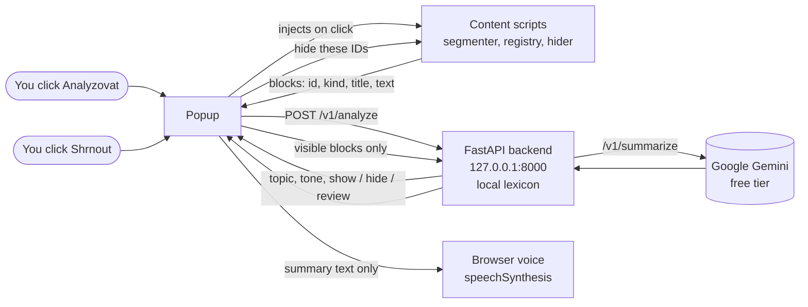

# ZenFeed

Chrome extension that hides the parts of a web page you do not want to read
(war, political conflicts, death reports, catastrophic scenarios, violence,
and separately a toxic or heated tone), and writes a short summary of what is
left, which it can read aloud in a synthetic voice. It never changes the page
text: hidden blocks sit behind a box with a "Zobrazit" button, and
"Zobrazit vše" puts the page back as it was. Nothing is read or sent until you
click. Scope: [`docs/mvp.md`](docs/mvp.md).

Student project (MENDELU, team of four). The popup is in Czech.

## How it works



- **Extension** (`extension/`, Manifest V3, vanilla JS, no build step): permissions `activeTab`, `scripting`, `storage`, and network access only to `http://127.0.0.1:8000`.
- **Backend** (`backend/`, FastAPI + Pydantic): `/v1/analyze` classifies blocks with a local lexicon (`lexicon-2`), no external service. `/v1/summarize` calls Gemini and works only with a key.
- **Categories** are frozen in [`docs/kategorie-mvp.md`](docs/kategorie-mvp.md). A block is hidden only when its topic or tone is switched on and the match is strong. An uncertain match stays visible.

Details: [`docs/architecture.md`](docs/architecture.md), API: [`docs/API.md`](docs/API.md), privacy: [`docs/privacy.md`](docs/privacy.md).

## Install

You need Git, Python 3.11 or newer, and Google Chrome (or another Chromium browser, for example Brave or Edge). Node.js 22+ is needed only for the tests.

### 1. Get the code

```bash
git clone https://github.com/Honza09/ZenFeed.git
cd ZenFeed
```

### 2. Start the backend

Create and activate a virtual environment and install the dependencies:

```bash
python3 -m venv .venv
source .venv/bin/activate        # Windows PowerShell: .venv\Scripts\Activate.ps1
pip install -r backend/requirements-dev.txt
```

Start the server from the repository root and leave it running. The extension calls exactly this address and port:

```bash
uvicorn app.main:app --app-dir backend
```

Check it: <http://127.0.0.1:8000/health> shows `{"status":"ok","analyze_provider":"lexicon"}`.

Hiding works without any key. **For summaries** you need a Gemini API key from the free tier, without a billing account ([`docs/rozhodnuti-zf-25.md`](docs/rozhodnuti-zf-25.md)):

1. Copy the example settings: `cp .env.example .env`.
2. Put the key into `.env` as `ZENFEED_AI_API_KEY=...`. Never commit `.env`.
3. Start the server with the settings:

   ```bash
   uvicorn app.main:app --app-dir backend --env-file .env
   ```

Without a key the popup says that the summary is not available. Everything else works.

### 3. Load the extension

1. Open `chrome://extensions`.
2. Turn on **Developer mode** (top right).
3. Click **Load unpacked** and select the `extension/` folder of the repository.
4. Optionally pin ZenFeed to the toolbar (puzzle icon → pin).

After a code change, click the reload arrow on the ZenFeed card and reload the page.

## Use

1. Open an ordinary web page (an article, a news list, a forum, Wikipedia).
2. Click the ZenFeed icon. Nothing has been read from the page yet.
3. Under **Skrýt témata** and **Skrýt tón**, switch on what you do not want to read. The choice is remembered.
4. Click **Analyzovat**. The popup reports how many blocks it found and hid, and each hidden block is replaced by a box "Skryto: …" with the buttons **Zobrazit** and **Proč byl tento obsah skryt?**.
5. **Zobrazit** on a box shows that one block. **Zobrazit vše** shows the whole page as it was. **Znovu skrýt** hides it again.
6. Under **Shrnutí**, choose the language and click **Shrnout viditelný obsah**. Only the blocks that stayed visible are sent. The summary says which settings were used and which topics were left out.
7. **Přehrát** reads the summary (not the page) in a voice of your system, marked as a synthetic voice. **Pauza** and **Ukončit čtení** control it. Reading stops when the popup closes.

Pages that ZenFeed cannot work on (`chrome://`, `about:`, the Chrome Web Store, local `file://` pages) and pages with very little text get a message instead of a result ([`docs/edge-states.md`](docs/edge-states.md)). Do not use ZenFeed on pages with personal data (e-mail, banking), because the text of their blocks would be sent to the backend.

## Checks and tests

Run from the repository root with the virtual environment active. CI runs the same commands on every pull request.

```bash
ruff check backend
pytest backend
python .github/scripts/check_extension.py extension/manifest.json
node --test tests/extension/*.test.mjs
node tests/extension/hider-browser.mjs
```

The last command needs Google Chrome (set `CHROME_PATH` if it is elsewhere). The end-to-end regression drives the real extension in headless Brave, with the real backend and a fake Gemini, so no key is needed and nothing leaves the machine:

```bash
bash tests/extension/run-e2e.sh
```

`bash tests/extension/run-demo.sh` starts the backend and an offline demo page for the final presentation ([`docs/demo/scenar.md`](docs/demo/scenar.md)). `MEASURE=3 bash tests/extension/run-e2e.sh` measures latency and summary compression instead ([`docs/testing/mereni-latence.md`](docs/testing/mereni-latence.md)). More in [`docs/DEVELOPMENT.md`](docs/DEVELOPMENT.md) and [`docs/TESTING.md`](docs/TESTING.md).

## Known limitations

The full list with remaining risks is in [`docs/zname-omezeni.md`](docs/zname-omezeni.md). The main ones:

- **Classification is a word list, not a model.** On the annotated blocks it hides about 38 % of what it should (with about 87 % of its hides correct), so the 80 % target is not met yet ([`docs/testing/pilot/lexicon-2.md`](docs/testing/pilot/lexicon-2.md)). It does not understand negation, irony or context. Classification by Gemini is ready but off until the team decides ([`docs/klasifikace-modelem.md`](docs/klasifikace-modelem.md)).
- **The summary goes to Google.** The visible text is sent to the Gemini free tier, which may use it to improve Google's products. The summary can contain mistakes and is not checked for content.
- **The backend runs only locally** on `127.0.0.1:8000`. Another address needs a change in the extension.
- Only content that is already loaded is analyzed, not iframes or shadow DOM. Large wrapper blocks and table cells are never hidden. After a reload the page shows everything again.
- The voice depends on the system's installed voices. It is a generic voice, not a named character.

## Contributing

Task list: [`docs/backlog/`](docs/backlog/README.md). Workflow, commit conventions and the Definition of Done: [`CONTRIBUTING.md`](CONTRIBUTING.md). Documentation index: [`docs/README.md`](docs/README.md).
