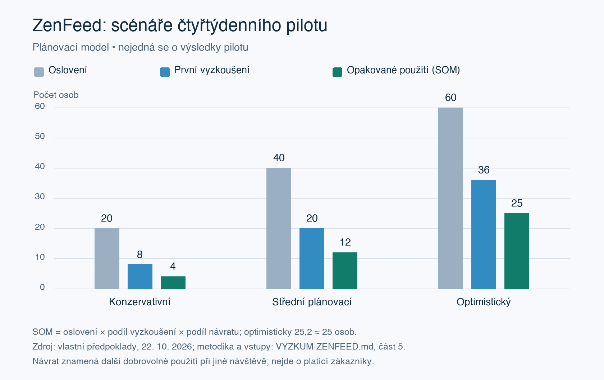

# ZenFeed — analýza uživatelů, trhu a ověření konceptu

**Semestrální projekt · koncept ke schválení · 22. 10. 2026**  
Příloha k [produktovému pitchi](PRODUKTOVY-PITCH.md) a [projektovému pitchi](PROJEKTOVY-PITCH.md).

## 1. Vymezení produktu

ZenFeed je připravované rozšíření pro Chrome. Z textu právě načtené HTML stránky vytvoří **samostatné shrnutí podle preferencí uživatele** a nabídne jeho poslech syntetickým hlasem známé historické osobnosti. Uživatel může například požadovat vynechání politických konfliktů, katastrofických scénářů nebo zpráv o úmrtí a omezení toxického či vyhroceného podání. Konkrétní historická osobnost zatím není vybrána.

Koncept počítá s češtinou i angličtinou a různými doménami: zpravodajstvím, blogy, odbornými texty i diskuzemi. Nejde o službu omezenou na studenty, český trh nebo jediný portál. Původní text stránky zůstává zachován; rozšíření jej nepřepisuje ani neskrývá. Získává již načtený text, nikoli automaticky celý web, nenačtené příspěvky nebo obsah videí.

Obecná použitelnost je cílem návrhu, nikoli již ověřenou kompatibilitou se všemi stránkami. Některé dokumenty mají málo textu, nestandardní strukturu nebo technicky nepřístupný obsah. Úspěšnost získání textu musí ověřit prototyp na různých doménách. Při nedostatku vhodného textu musí uživatel dostat srozumitelné vysvětlení.

### Co znamená personalizace

Je třeba odlišovat tři operace:

- **Zkrácení:** zredukovat rozsah při zachování hlavního sdělení.
- **Výběr:** na výslovnou žádost uživatele některá témata do shrnutí nezahrnout.
- **Úprava podání:** odstranit expresivní či toxické formulace z výsledného shrnutí bez vymýšlení jiných skutečností.

Negativní událost není automaticky toxický text. Pokud uživatel vynechá zprávy o úmrtí, výsledný přehled může být záměrně neúplný; nemá proto být označován jako úplné nebo automaticky nestranné shrnutí stránky. Návrh prototypu počítá s viditelným uvedením použitých preferencí a dostupností originálu. Pokud po výběru nezbude relevantní obsah, má o tom výsledek informovat, místo aby vytvořil náhradní pozitivní příběh.

**Stav projektu:** schvalování konceptu. Vlastní rozhovory a testy ZenFeed zatím neproběhly. Následující výzkum ověřuje potřebu a existenci uživatelů obdobných nástrojů; neprezentuje hotový produkt ani dosažené výsledky.

## 2. Co dokládá existenci potenciálních uživatelů

Argumentace stojí na třech odlišných skupinách důkazů:

| Důkaz | Co podporuje | Co z něj nelze odvodit |
| --- | --- | --- |
| Přímé veřejné požadavky na shrnutí webových stránek | Lidé tuto úlohu skutečně řeší a hledají pohodlnější postup. | Kolik jich přejde na ZenFeed a zda chtějí všechny jeho funkce. |
| Výpovědi o zahlcení, nežádoucích tématech a nedůvěře k AI | Potřebu kontroly a konkrétní bariéry přijetí. | Účinnost ZenFeed nebo zdravotní přínos. |
| Existující rozšíření a údaje Chrome Web Store | Kategorie nástrojů v prohlížeči má reálnou uživatelskou základnu. | Počet uživatelů samotné funkce shrnutí nebo poptávku po historickém hlasu. |

### Statistiky a odborné poznatky

- **Reuters Institute, Digital News Report 2026**, zveřejněno 16. 6. 2026: někdy či často se zprávám vyhýbá **42 % respondentů napříč 48 sledovanými trhy**. Jde o mezinárodní dotazníkové zjištění o zprávách. Podporuje relevanci zpravodajské situace použití, nikoli automaticky potřebu každého čtenáře webu. [Primární zdroj](https://reutersinstitute.politics.ox.ac.uk/digital-news-report/2026/dnr-executive-summary).
- **Robertsonová a kol., Nature Human Behaviour, 2023:** v experimentálním prostředí Upworthy zvýšilo každé další negativní slovo v průměrném titulku míru prokliku relativně o **2,3 %**. Jde o mechanismus získávání pozornosti; studie neprokazuje zdravotní dopad ani účinnost personalizovaných shrnutí. [Recenzovaná studie](https://www.nature.com/articles/s41562-023-01538-4).
- **Chrome Web Store, stav zobrazený při rešerši 22. 10. 2026:** Sider uvádí **5 000 000 uživatelů**, AI Summary Helper **212** a Summate **18**. Jde o údaj obchodu v čase, nikoli naše měření aktivity či platících zákazníků. Sider nabízí více funkcí, proto jeho počet nelze přisoudit pouze shrnování. Výrazný rozdíl mezi produkty zároveň ukazuje, že existence kategorie nezaručuje úspěch nové aplikace. Počty nesčítáme jako unikátní osoby. [Sider](https://chromewebstore.google.com/detail/sider-chat-with-all-ai-gp/difoiogjjojoaoomphldepapgpbgkhkb?hl=en-GB), [AI Summary Helper](https://chromewebstore.google.com/detail/ai-summary-helper-%E2%80%93-summa/hldbejcjaedipeegjcinmhejdndchkmb), [Summate](https://chromewebstore.google.com/detail/summate-ai-page-summarize/pmdmknkgcjkkigibpblmekjgfhnpmhfm).
- **Maynez a kol., ACL 2020:** studie abstraktivního shrnování dokumentuje možnost generování obsahu nevěrného vstupnímu dokumentu. Její výsledky nelze použít jako míru chybovosti dnešního neurčeného modelu; zdůvodňují potřebu ruční kontroly faktů v prototypu. [Recenzovaná studie](https://aclanthology.org/2020.acl-main.173/).

**Interpretace:** Problém ani kategorie nejsou založeny pouze na představě týmu. Pro ZenFeed je však nutné ověřit jejich konkrétní průnik: lidé chtějící shrnutí přímo v Chromu, kteří současně oceňují výběr podle témat a použijí jej opakovaně. Pro historický hlas zatím přímý důkaz potřeby nemáme.

## 3. Reddit: osm veřejných diskuzí

Rešerše je kvalitativní a účelová. Výběr není reprezentativní pro českou ani anglicky mluvící populaci; sebevýběr autorů a anglicky vedené komunity jej ovlivňují. Některé komentáře propagují vlastní produkty. Výpovědi nejsou rozhovory provedené týmem a počet hlasů neinterpretujeme jako počet zákazníků. Pokud přesné datum nebylo dostupné, nedopočítáváme jej z relativního časového údaje.

### R1 — Looking for AI Tools for Summarizing, Note-Taking, and Organizing Information Across Platforms

**Komunita:** r/PKMS. **Datum:** přesný den v načteném zobrazení nedostupný.  
**Zdroj:** [původní diskuze](https://www.reddit.com/r/PKMS/comments/1ggjrcc/looking_for_ai_tools_for_summarizing_notetaking/); načteno tělo i komentáře.

Autor popisuje rozsáhlé online čtení a hledá ukládání, anotaci a AI shrnování webových stránek. Zmiňuje také jednoduchost, náklady a soukromí. Krátká citace: „I do a lot of online reading and want a tool to save web pages for later, highlight sections, and then summarize them with AI.“

**Význam pro ZenFeed:** přímá indicie potřeby shrnování napříč webem, nejen zpráv. Požadavky jsou širší než ZenFeed a autor používá zejména telefon; tento nález není důkazem ochoty instalovat rozšíření pro desktopový Chrome.

### R2 — Is there a way to summarize web pages with one click on Safari?

**Komunita:** r/mac. **Datum:** přesný den v načteném zobrazení nedostupný.  
**Zdroj:** [původní diskuze](https://www.reddit.com/r/mac/comments/1i8v8f0/is_there_a_way_to_summarize_web_pages_with_one/); načteno tělo i komentáře.

Autor nyní kopíruje odkazy do AI chatu a hledá rychlejší shrnutí přímo v prohlížeči, také pro neanglický obsah. Citace: „I’d love a more streamlined method if it exists.“

**Význam pro ZenFeed:** přímý doklad ručního náhradního postupu a potřeby pohodlnější integrace. Zároveň jde o Safari; nález podporuje problém, nikoli ochotu přejít na Chrome. V diskuzi autor následně uvádí, že mu doporučený postup funguje, takže původní potřebu již mohla vyřešit existující alternativa.

### R3 — News summary resource?

**Komunita:** r/digitalminimalism. **Datum:** přesný den v načteném zobrazení nedostupný.  
**Zdroj:** [původní diskuze](https://www.reddit.com/r/digitalminimalism/comments/1jobg4x/news_summary_resource/); načteno tělo i komentáře.

Autor chce přehled událostí ve dvou až třech větách a možnost pokračovat ke zdroji. Snaží se omezit sledování zpráv, ale zachovat orientaci.

**Význam pro ZenFeed:** potřeba krátkého výsledku a zachované cesty k originálu. Nález se týká zpravodajství a částečně souhrnu více zdrojů; ZenFeed v MVP shrnuje právě otevřenou stránku, nikoli automaticky více webů.

### R4 — How do you balance digital minimalism with the need to be informed?

**Komunita:** r/digitalminimalism. **Datum:** přesný den v načteném zobrazení nedostupný.  
**Zdroj:** [původní diskuze](https://www.reddit.com/r/digitalminimalism/comments/1ikscl3/how_do_you_balance_digital_minimalism_with_the/); načteno tělo i komentáře.

Autor nechce kvůli občanské angažovanosti zcela přestat sledovat dění, současný způsob ale vnímá jako zatěžující. Komentující navrhují newslettery a RSS.

**Význam pro ZenFeed:** indicie potřeby kontroly místo úplného odpojení. Současně ukazuje, že vhodný newsletter může problém vyřešit bez instalace další aplikace. Neprokazuje zdravotní účinek filtrace.

### R5 — Boring Report: a news app that uses AI language models to remove sensationalism while preserving essential information

**Komunita:** r/apple. **Datum:** 7. 5. 2023.  
**Zdroj:** [původní diskuze](https://www.reddit.com/r/apple/comments/13ajz6z/boring_report_a_news_app_that_uses_ai_language/); dostupná stránka a indexovaný obsah komentářů.

Vlákno zahájili autoři aplikace. Komentující žádají vlastní témata, blokování zdrojů a rozšíření pro běžné prohlížení; další zpochybňují věrnost přepisu. Citace komentáře: „How do you ensure it's not changing the meaning of the text though?“

**Význam pro ZenFeed:** blízká potřeba klidnějšího shrnutí a personalizace, ale také zásadní požadavek zachovat význam. Pochvaly konkurenta a sebehlášené stažení nejsou měřením jeho dlouhodobého používání ani důkazem zájmu o ZenFeed.

### R6 — Great, more forced AI trash.

**Komunita:** r/InoReader. **Datum:** přesný den v načteném zobrazení nedostupný.  
**Zdroj:** [původní diskuze](https://www.reddit.com/r/InoReader/comments/1j4vhmp/great_more_forced_ai_trash/); načteno tělo i komentáře.

Autor odmítá vnucená AI shrnutí. Komentáře se liší v názoru na jejich přínos a řeší přesnost, volitelnost i soukromí.

**Význam pro ZenFeed:** důležitý protidůkaz předpokladu, že každý chce AI výsledek. Zpracování má spouštět uživatel a původní čtení zůstává dostupné. Kritika ve vlákně není ověřením současných funkcí či datových postupů Inoreaderu.

### R7 — created a chrome extension to help on reading the web pages if you have local llm running

**Komunita:** r/LocalLLaMA. **Datum:** přesný den z dostupného výňatku neověřen.  
**Zdroj:** [původní diskuze](https://www.reddit.com/r/LocalLLaMA/comments/1exgze4); využit indexovaný text příspěvku a komentářů, přímé načtení selhalo.

Autor zveřejňuje vlastní rozšíření pro shrnutí, překlad a extrakci myšlenek s lokálním modelem a uloženými prompty. V komentáři se objevuje zájem o otevřené řešení a způsob získávání textu.

**Význam pro ZenFeed:** konkurenční směr a preference kontroly nad zpracováním. Jde především o autorskou prezentaci, nikoli nezávislé ověření velikosti poptávky. ZenFeed zatím neslibuje lokální běh.

### R8 — Raycast AI web browsing

**Komunita:** r/raycastapp. **Datum:** přesný den z dostupného výňatku neověřen.  
**Zdroj:** [původní diskuze](https://www.reddit.com/r/raycastapp/comments/1l0ubak); dostupný indexovaný obsah, přímé načtení selhalo.

Autor popisuje rozdíl mezi webovým vyhledáváním a schopností otevřenou stránku skutečně přečíst a shrnout bez dalšího rozšíření.

**Význam pro ZenFeed:** doklad frustrace z integrace a dostupnosti konkrétního obsahu. Podporuje práci s textem již načtené stránky; není to požadavek na omezení negativity ani na dabing.

### Syntéza potřeb a mezer

| Potřeba / bariéra | Relevantní nálezy | Důsledek pro koncept |
| --- | --- | --- |
| Shrnutí přímo při prohlížení | R1, R2, R8 | Zpracovat aktuální stránku bez ručního kopírování. |
| Kratší přehled a kontrola zahlcení | R3, R4 | Stručný výsledek a snadno srozumitelné preference. |
| Volba obsahu a důvěra ve význam | R5 | Testovat výběr témat i věrnost výsledku. |
| Odmítání vnucené AI a obavy o data | R6, R7 | Dobrovolná aktivace a jasné vysvětlení zpracování. |
| Historický hlas | Žádný přímý nález | Ověřit samostatně; nepovažovat za doložený důvod používání. |

Nejde o osm potvrzených zájemců o produkt. Nálezy tvoří argument, že existují lidé s relevantními úlohami a frustracemi. Propojení všech potřeb v jednom produktu je stále hypotéza.

## 4. Uživatelé a konkurenční prostředí

### Segmenty podle chování

Segmenty se překrývají a jejich velikosti nelze sčítat. Nejde o demografické omezení produktu.

| Segment | Potřeba a motivace | Současný postup a jeho omezení | Možný přínos ZenFeed | Bariéra adopce |
| --- | --- | --- | --- | --- |
| Primární: pravidelní čtenáři webu používající nebo hledající shrnutí | Rychle zjistit, zda je stránka relevantní, a získat přehled. | Ruční čtení nebo kopírování do AI chatu; další kroky a opakované zadávání. | Shrnutí načtené stránky v prostředí prohlížeče. | Existující nástroj už může být dostatečný; nedůvěra k přesnosti. |
| Primární: čtenáři požadující kontrolu témat a podání | Omezit nežádoucí či emočně zatěžující obsah podle vlastní volby. | Přeskakování, vypnutí zpráv, obecné shrnutí či newsletter. | Personalizovaný výběr ve výsledném shrnutí. | Riziko neúplného kontextu a nesprávného odfiltrování. |
| Sekundární: lidé preferující poslech | Získat přehled poslechem místo čtení. | Podcast nebo převod celého textu na řeč nemusí odpovídat požadovanému výběru. | Poslech právě vytvořeného shrnutí. | Nepřirozený hlas, čekání nebo rušivá stylizace. |
| Průřezově: čeští i anglicky čtoucí uživatelé | Používat stejný postup na různých webech. | Různá jazyková a technická podpora alternativ. | Jeden postup pro obě jazykové varianty. | Rozdílná kvalita textu, hlasu a získání obsahu. |

Studenti, zaměstnanci i lidé čtoucí ve volném čase mohou do těchto skupin patřit. Jejich samotná příslušnost ale potřebu nedokazuje. Pro nábor je podstatná nedávná konkrétní zkušenost a používání Chromu.

### Porovnání s alternativami

Veřejné nabídky ověřeny při rešerši 22. 10. 2026. Funkce uvedené dodavateli nejsou výsledkem našeho přímého testu. Neuvedenou funkci nepovažujeme automaticky za neexistující.

| Alternativa | Přínos podle nabídky | Co znamená pro ZenFeed |
| --- | --- | --- |
| [Summate](https://chromewebstore.google.com/detail/summate-ai-page-summarize/pmdmknkgcjkkigibpblmekjgfhnpmhfm) | Shrnutí načtených stránek, různé délky a možnost místního zpracování za uvedených podmínek. | Velmi blízký základ. Prosté shrnutí stránky samo o sobě není odlišení. |
| [AI Summary Helper](https://chromewebstore.google.com/detail/ai-summary-helper-%E2%80%93-summa/hldbejcjaedipeegjcinmhejdndchkmb) | Shrnutí webu, jazyky, vlastní prompty a různé způsoby zpracování. | Preference lze částečně vyjádřit vlastním promptem. ZenFeed musí ověřit přínos jednoduššího nastavení konkrétních témat. |
| [Sider](https://chromewebstore.google.com/detail/sider-chat-with-all-ai-gp/difoiogjjojoaoomphldepapgpbgkhkb?hl=en-GB) | Široký AI asistent v prohlížeči, práce s webovými stránkami a prompty. | Silná a používaná alternativa; příležitostí je úzce zaměřený, srozumitelný postup. Jednodušší ovládání je hypotéza k testu. |
| [Boring Report](https://apps.apple.com/us/app/boring-report-unbiased-news/id6446786839) | Omezení senzacechtivosti a stručnější zpravodajství. | Překryv u způsobu podání; ZenFeed má pracovat s uživatelem otevřenou stránkou napříč typy webů. |
| AI chat s ručně vloženým textem | Flexibilní požadavky a kontrola zadání; skutečný postup popsaný v R2. | Nejsnazší náhrada. Rozšíření musí přinést pohodlí a opakovaně použitelný postup. |
| Newsletter, RSS nebo ruční vynechávání | Vlastní výběr a nízká potřeba dalšího nástroje; R3–R4. | Část uživatelů nemusí ZenFeed potřebovat vůbec. |

**Příležitost pro ZenFeed:** spojit shrnutí aktuální stránky, srozumitelné nastavení vynechávaných témat a poslech výsledku. Nemáme podklad pro tvrzení, že tuto kombinaci nikdo jiný neumí. Historický hlas je součást konceptu, ale jeho přitažlivost ani dlouhodobá hodnota zatím nejsou doloženy.

## 5. Velikost trhu a scénáře adopce

### Velikost prostředí není velikost poptávky

[ITU, Facts and Figures 2025, zveřejněno 17. 11. 2025](https://www.itu.int/en/mediacentre/Pages/PR-2025-11-17-Facts-and-Figures.aspx), odhaduje **6 miliard uživatelů internetu celosvětově**. [ČSÚ, údaje za 2025 zveřejněné 11. 11. 2025](https://csu.gov.cz/ict-v-domacnostech-a-uzivatele-ict), uvádí v ČR přibližně **7,7 milionu uživatelů internetu ve věku 16+**. Tyto hodnoty jsou pouze kontext a horní populační základna. Neříkají, kolik lidí používá desktopový Chrome, čte v podporovaných jazycích a chce personalizované shrnutí.

Angličtina otevírá možnost mezinárodního použití, ale neopravňuje zahrnout všechny uživatele internetu do TAM. Stejně tak 42% vyhýbání se zprávám není konverzní míra na rozšíření a nelze jím násobit globální internetovou populaci.

| Úroveň | Vymezení pro ZenFeed | Co lze nyní poctivě vyčíslit |
| --- | --- | --- |
| TAM — celkový relevantní trh | Lidé s opakovanou potřebou personalizovaného shrnutí při čtení webu. | Spolehlivý počet není dostupný. Globální internetová populace je pouze horní kontext. |
| SAM — obsloužitelná část | Z TAM uživatelé podporovaného Chromu, českých či anglických textů a technicky zpracovatelných stránek. | Chybí datový průnik těchto podmínek; číselný odhad by závisel na libovolných procentech. |
| SOM — dosažitelný pilot | Lidé získaní konkrétním náborem, kteří po vyzkoušení znovu dobrovolně použijí prototyp. | Lze sestavit transparentní kapacitní scénáře, nikoli zatím měření. |

Tato analýza proto nevydává počet českých čtenářů zpráv za velikost celého trhu ZenFeed a nevytváří zdánlivě přesný SAM. Silnější současný argument představují přímé výpovědi a existující uživatelé konkurenčních nástrojů. Pro upřesnění trhu bude nutný náborový dotazník zjišťující současné postupy, prohlížeč, jazyk, opakovanost potřeby a ochotu zkusit prototyp.

### Kapacitní scénáře pilotu

Následující čtyřtýdenní pilot je plánovací návrh po schválení konceptu. Nábory nejsou omezeny na jednu školu ani zemi. Počty oslovených a konverze jsou **pracovní předpoklady**, nikoli statistiky nebo závazky. Střední varianta není prokázanou nejpravděpodobnější prognózou.

| Scénář | Unikátně oslovení vhodní lidé N | Podíl prvního vyzkoušení p | První vyzkoušení N × p | Podíl návratu q | Opakovaní uživatelé N × p × q |
| --- | ---: | ---: | ---: | ---: | ---: |
| Konzervativní | 20 | 40 % | 8 | 50 % | 4 |
| Střední plánovací | 40 | 50 % | 20 | 60 % | 12 |
| Optimistický | 60 | 60 % | 36 | 70 % | přibližně 25 |

SOM zde znamená návrat alespoň při jedné další návštěvě, nikoli předplatitele nebo dlouhodobě aktivního zákazníka. Optimistický výpočet je 60 × 0,60 × 0,70 = 25,2, zaokrouhleně 25. Bez úspěšného náboru a funkčního prototypu může být skutečný počet nula. Rozhovory a testy se mohou s pilotem překrývat; jejich účastníky nesčítáme jako další uživatele.

*Jednotka: osoby. Zdroj: vlastní kapacitní předpoklady, 22. 10. 2026; nejde o naměřenou adopci. [Vstupy](assets/zenfeed-adopce.json), [generátor grafu](assets/vytvorit-graf.py).*

## 6. Plán ověření a rozhodovací kritéria

### Ověření potřeby

Navrhujeme 5–8 rozhovorů s dospělými uživateli Chromu, kteří pravidelně čtou web a mají nedávnou zkušenost s ručním shrnováním nebo výběrem obsahu. Zahrneme české i anglické čtení, více druhů stránek a také uživatele spokojené se současnou alternativou. Nábor nebude omezen na studenty; malý vzorek nebude reprezentativní.

Otázky se zaměří na poslední konkrétní situaci: co četli, proč potřebovali shrnutí, jak postupovali, co jim vadilo a které informace chtěli vynechat. Po ukázce zjišťujeme rozdíl oproti obvyklému postupu, nikoli pouze to, zda se jim nápad líbí. Výstupem budou anonymizované poznámky, opakující se potřeby a příklady odmítnutí. Dosud taková data nemáme.

### Test prototypu

Navrhujeme 3–5 účastníků a malou sadu přibližně 24 textových stránek: české a anglické články, blogy, odborné texty a diskuze, z více domén. Vzorek slouží k ověření různorodosti, nikoli k prohlášení, že rozšíření funguje na každém webu.

Dvě porovnání mají odlišný účel:

1. **Personalizované versus běžné shrnutí stejného vstupu:** ukáže přidanou hodnotu preferencí. Obě varianty vzniknou za srovnatelných podmínek; pořadí se mezi účastníky prohodí. Účastník předem zvolí preference a po zobrazení posoudí jejich dodržení.
2. **ZenFeed versus obvyklý postup uživatele:** ukáže čas a úsilí. Použijeme obsahově a délkou srovnatelné stránky, které účastník nečetl, a prohodíme přiřazení. Změříme čas k předem definovanému úkolu a správné odpovědi o ponechaném obsahu.

U každé stránky se ručně označí relevantní a vyloučená témata. Nezávislé označení dvěma hodnotiteli a zaznamenání neshod pomůže odhalit nejednoznačné preference. Část vstupů se oddělí pro ladění a část pro konečné vyhodnocení.

**Navržený ukazatel 1 — respektování preferencí:** alespoň 80 % vyhodnotitelných případů musí správně provést zadaný výběr a zachovat dostupné relevantní informace. Případ je kombinace stránky a konkrétního nastavení; není to 80 % vět ani 80 % uživatelů. Zvlášť se zaznamená neoprávněné vynechání a proniknutí vyloučeného tématu. Případy bez relevantního zbytku se hodnotí podle správného oznámení, nikoli podle vytvořeného množství textu.

**Navržený ukazatel 2 — čas k požadovanému přehledu:** alespoň 20% pokles mediánu oproti obvyklému postupu bez horších odpovědí o ponechaném obsahu. Nedokončené úlohy se vykážou jako neúspěchy a nesmějí se prostě odstranit z výsledku. S malým vzorkem půjde o orientační poznatky, nikoli statistický důkaz.

### Faktická věrnost a hranice výběru

Záměrné vynechání podle preference není stejná chyba jako vymyšlený nebo obrácený fakt. Kontrola se zaměří na věrnost **ponechaných informací**, zachování nezbytného kontextu a pravdivé označení rozsahu výsledku. Pokud by vynechání změnilo význam ponechaného tvrzení, nelze je prezentovat jako úplnou a pravdivou zprávu bez vysvětlení omezení.

Ruční kontrola ověří osoby, čísla, příčiny, čas a míru nejistoty. Kritická chyba musí být opravena před dalším pilotem. Nižší negativní sentiment sám neprokazuje kvalitu ani pravdivost.

### Dabing a opakované použití

Účastník musí bez pomoci spustit a zastavit přehrání shrnutí a rozumět jeho obsahu. Hodnotíme češtinu i angličtinu a srozumitelné označení syntetického hlasu. Historický hlas lze při testu porovnat s běžným hlasem čtoucím stejný text, v prohozeném pořadí. Běžný hlas je kontrolní podmínka, nikoli náhrada požadovaného dabingu v MVP.

Zaznamenáme čas do začátku audia, potíže s ovládáním, preferenci hlasu a dobrovolný návrat při jiné návštěvě. Návrat k produktu a návrat k poslechu se vyhodnotí odděleně. Krátký pilot neprokazuje dlouhodobou retenci.

### Rozhodnutí o pokračování

Pokračování má oporu, pokud lidé rozpoznají přínos preferencí, výsledek je věrný a postup jim usnadní práci. Pokud běžné shrnutí postačuje, je potřeba upravit hodnotovou nabídku. Pokud se nepotvrdí zájem o historický hlas, jde o zjištění pro další rozhodnutí o funkci. Při opakovaném zkreslování významu není vhodné rozšiřovat pilot bez opravy.

## 7. Rizika, závislosti a další rozhodnutí

| Riziko | Důsledek | Postup ověření |
| --- | --- | --- |
| Chybná interpretace preferencí | Zůstane nežádoucí obsah nebo zmizí potřebný. | Jasné názvy kategorií, konkrétní příklady a ručně označené testovací případy. |
| Neúplný nebo zkreslený výsledek | Uživatel si vytvoří mylný přehled. | Označit použitá omezení a ověřovat věrnost ponechaných informací. |
| Různorodost načtených stránek | Navigace či reklamy se zamění za hlavní text; část obsahu chybí. | Obecná extrakce, test různých domén, detekce nedostatečného vstupu. |
| Soukromí | Text stránky může obsahovat osobní či pracovní informace. | Zpracování spouští uživatel; před nasazením určit poskytovatele, přenos a uchovávání dat. Neodesílat automaticky celé prohlížení. |
| Závislost na textové a hlasové AI | Čekání, náklady a nedostupnost služby. | Technické ověření v rané fázi, měření ceny a odezvy na reprezentativních textech. |
| Nevhodný historický hlas | Slabá srozumitelnost nebo nevhodná stylizace. | Vybrat konkrétní hlas, ověřit podmínky použití a kvalitu v obou jazycích. |
| Silná konkurence | Uživatel nemá důvod měnit nástroj. | Porovnat preference s běžným shrnutím a skutečným náhradním postupem. |
| Přecenění rozsahu | Vývoj spotřebuje čas určený k ověření potřeby. | Soustředit MVP na získání textu, preference, shrnutí a dabing; přepis webu ani autonomní agent nejsou potřebné. |

Před implementací je nutné vybrat textový a hlasový model, konkrétní historickou osobnost, způsob provozu, limit nákladů a odpovědnosti v týmu. Kalendářní termíny navazující realizace budou stanoveny po schválení konceptu.

## 8. Závěr pro schválení konceptu

**Doložené skutečnosti:** existují lidé výslovně hledající shrnutí webových stránek a používané nástroje integrující AI do prohlížeče. **Indicie:** některým čtenářům vadí zahlcení, nechtěná témata a nepohodlí ručního přenášení textu. **Hypotéza ZenFeed:** jednoduché preference pro výběr obsahu přinesou více než standardní shrnutí, a možnost poslechu tuto hodnotu doplní.

Koncept má věcně podložený důvod k ověření v semestrálním projektu. Zatím nemá potvrzený počet vlastních zájemců, obchodní model ani účinek na psychickou pohodu. Nejbližším krokem je schválit návrh, provést rozhovory a otestovat prototyp napříč weby v obou jazycích. Úspěch bude posuzován podle užitku a správnosti, nikoli pouze podle toho, zda se podaří technicky vygenerovat text a audio.
